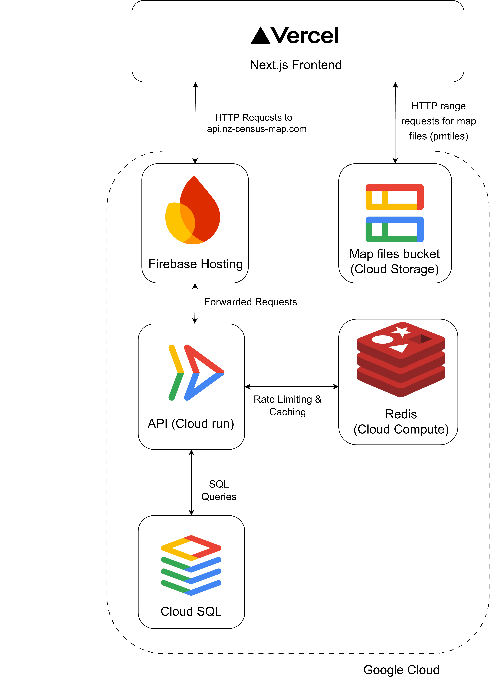

# NZ Census Map Backend


_Main repository: [nz-census-map](https://github.com/HugoPhibbs/nz-census-map)_

## Instructions

* You will need [uv](https://docs.astral.sh/uv/getting-started/installation/) and Python 3.14 installed.

* To install dependencies:
```shell
uv sync
```

### Filling out the `.env` file
* You will need to fill out the `.env` file for deployments and local development, the general format is:

```
STATS_NZ_API_KEY=XXXXX

USE_DEV_DB=false
USE_DEV_CREDENTIALS=true

MCP_BEARER_TOKEN=XXXXX

DB_NAME=census_db
DB_USER=api_user
DB_PASSWORD=XXXXX
DB_HOST=127.0.0.1

BUCKET_NAME=nz-census-map-api-bucket
GCP_REGION=europe-west2
PROJECT_ID=nz-census-map

FRONTEND_DOMAIN=https://nz-census-map.com

ANTHROPIC_API_KEY=XXXXX

REDIS_HOST=localhost
REDIS_PASSWORD=XXXXX

BUCKET_NAME=nz-census-map-api-bucket
```
### Running a local server
* First ensure you are using the GCP proxy to access the Cloud SQL DB, run (in a fresh terminal)
```shell
cloud-sql-proxy nz-census-map:europe-west2:nz-census-map-db # 
```
* Then start a IAP tunnel to the Redis instance
```shell
gcloud compute start-iap-tunnel nz-census-map-redis 6379 --local-host-port=localhost:6379 --zone=europe-west2-b
```
* Finally you can run a local production server:
```shell
python -m src.app
```

### Deployment

* The Cloud Run deployment is automated with GH actions, however, if you wish to do a fresh deployment (this will require the [gcloud](https://cloud.google.com/cli), [Firebase](https://firebase.google.com/docs/cli) and [Terraform](https://developer.hashicorp.com/terraform/install) CLIs installed, configured, and globally available), use
```shell
python -m deploy --tf-apply --update-api
```
* The full set of deploy options can be found with:
```shell
python -m deploy --help
```

## Using the API

* The URL of the API is _non-stable_, it changes depending on deployments. 
* The OpenAPI specification can be found in [openapi.yaml](./docs/openapi.yaml).

## System Architecture

* The overall architecture is largely a 3 tier architecture. 
* The frontend is written with Next.js and TypeScript, and the backend is written with Python using Flask & Psycopg. 
* The PostgreSQL database is deployed onto Google's [Cloud SQL](https://neon.com/), while Google's [Cloud Run](https://cloud.google.com/run) is used to deploy the HTTP API.
* Map files (as [pmtiles](https://docs.protomaps.com/pmtiles/)) are stored on [Cloud Storage](https://docs.cloud.google.com/storage/docs), and are fetched directly from the frontend using a presigned URL.
* Google's [Compute Engine](https://cloud.google.com/products/compute) is used to host a self-managed [Redis](https://redis.io/) instance for API caching and rate limiting.
* Firebase [Hosting](https://firebase.google.com/docs/hosting) is used to map the subdomain `api.nz-census-map.com` to the API within Cloud Run. It also provides a CDN to cache API requests


